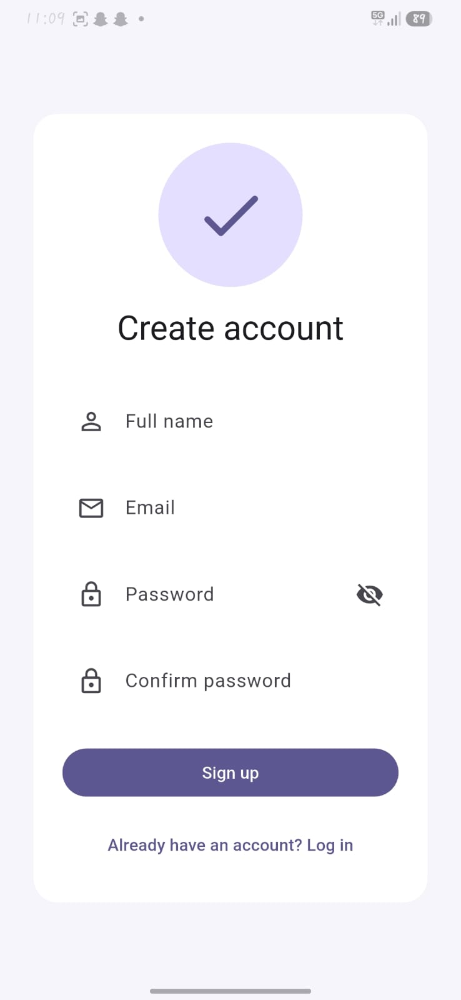
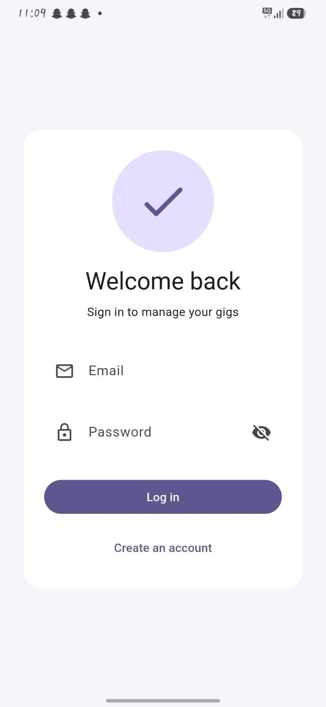
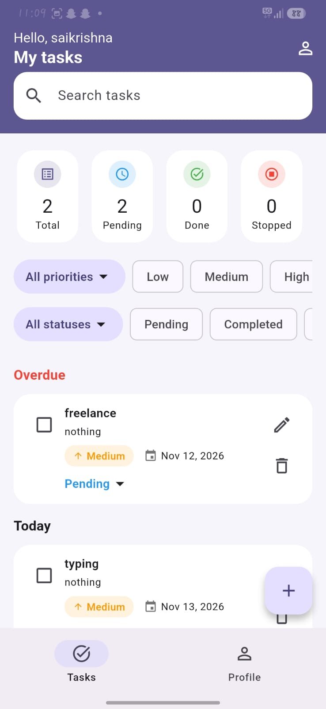
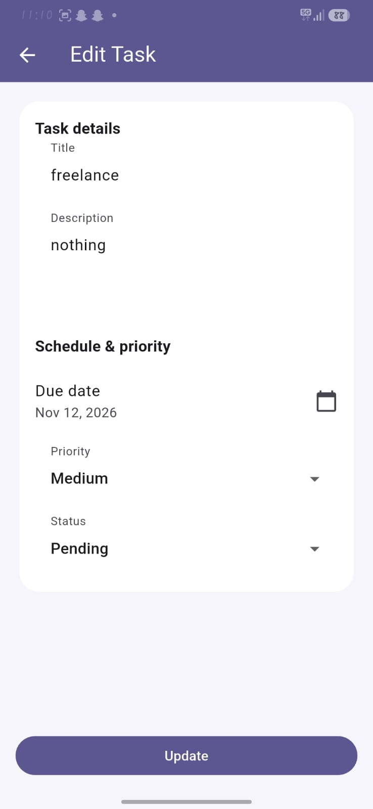

# Gig Task Manager

A Flutter-based task management application designed to help gig workers organize, track, and manage their daily tasks efficiently.

Built with Flutter, Dart, Firebase Authentication, and Cloud Firestore, the application provides secure user authentication, real-time task synchronization, task status tracking, and priority-based organization.

## Features

### Authentication
- Email and password registration.
- Secure login and logout.
- User-specific task access.

### Task Management
- Create, view, update, and delete tasks.
- Assign due dates and priority levels.
- Track task status:
  - Pending
  - Completed
  - Discontinued
- Real-time updates using Cloud Firestore.
- Offline persistence.

### Organization
- Filter tasks by status.
- Filter tasks by priority.
- Sort tasks by due date in ascending order.
- Responsive Material 3 user interface.

## Tech Stack

| Technology | Purpose |
| Flutter | Cross-platform UI development |
| Dart | Application programming language |
| Firebase Authentication | User authentication |
| Cloud Firestore | Cloud database and real-time synchronization |
| Provider | State management |
| GoRouter | Application navigation |
| Material 3 | UI design system |

## Architecture

The project follows a service-based architecture with Provider for state management.

lib/
├── core/
│   ├── theme/
│   └── validators/
├── models/
│   └── task_model.dart
├── services/
│   ├── auth_service.dart
│   └── task_service.dart
├── providers/
│   ├── auth_provider.dart
│   └── task_provider.dart
├── screens/
│   ├── auth/
│   ├── dashboard/
│   └── tasks/
├── widgets/
└── router/

Architecture principles:
- Models define application data structures.
- Services isolate Firebase operations.
- Providers manage application state and business logic.
- Screens handle user-facing application flows.
- Reusable widgets maintain UI consistency.

## Getting Started

### Prerequisites

- Flutter SDK
- Dart SDK
- Firebase account
- Android Studio or VS Code

### Installation

1. Clone the repository:

git clone https://github.com/Sai-krishna-sys/gig-task-manager.git
cd gig-task-manager

2. Install dependencies:

flutter pub get

3. Configure Firebase:

- Create a Firebase project.
- Register your Android/iOS application.
- Enable Email/Password authentication.
- Create a Cloud Firestore database.
- Configure the Firebase options in `lib/firebase_options.dart`.
- Deploy the Firestore security rules:

firebase deploy --only firestore:rules

4. Run the application:

flutter run

## Testing

Run static analysis:

flutter analyze

Run automated tests:

flutter test

## Security

- Firestore security rules restrict access to authenticated users' own data.
- User-specific task access is enforced through ownership checks.
- Firebase service-account credentials and private keys should never be committed to the repository.

## Author

Sai Krishna

GitHub: [Sai-krishna-sys](https://github.com/Sai-krishna-sys)

Built with Flutter and Firebase.

## Screenshots

### Authentication

### Dashboard

### Task Management
